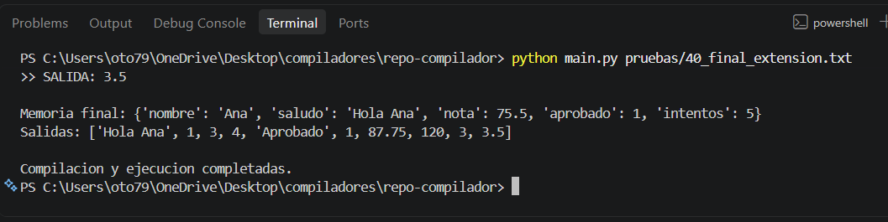

# Compilador en Python

Proyecto del curso de Compiladores de la Universidad San Pablo de Guatemala

**Catedrático:** Ing Carlos Isaac Arenas Guzmán  
**Estudiante:** Erick Ottoniel Flores Garcia 
**Carné:** 2400010

El compilador procesa programas escritos en español y los ejecuta en una máquina virtual

## Requisitos

- Python 3.10 o posterior
- No requiere instalar paquetes externos

Descarga el repositorio desde GitHub y abre una terminal en su carpeta principal
En Windows puedes usar `py -3` en lugar de `python`
En macOS o Linux puedes usar `python3` si `python` no está disponible

## Ejecutar

```bash
python --version
python main.py pruebas/40_final_extension.txt
python main.py pruebas/42_final_leer.txt
python main.py pruebas/20_ciclo_infinito_limite.txt --limite-pasos 50
```

El primer ejemplo muestra TAC y ejecuta el programa completo
El segundo solicita un dato por teclado
El tercero muestra cómo se detiene un ciclo que supera el límite de pasos

Para detener el proceso en una fase específica usa una de estas opciones

```bash
python main.py pruebas/03_control.txt --solo-lexer
python main.py pruebas/03_control.txt --solo-parser
python main.py pruebas/03_control.txt --solo-semantica
python main.py pruebas/03_control.txt --solo-tac
```

## Fases del compilador

1. **Lexer** convierte el texto en tokens
2. **Parser** revisa la sintaxis y crea el árbol AST
3. **Semántica** comprueba nombres y tipos
4. **TAC** genera instrucciones intermedias
5. **Máquina virtual** ejecuta las instrucciones

## Funcionalidades

Incluye variables enteras decimales cadenas y booleanos
También admite expresiones aritméticas y lógicas condiciones ciclos entrada por teclado y funciones con retorno

La demostración final imprime `Hola Ana` `1` `3` `4` `Aprobado` `1` `87.75` `120` `3` y `3.5`

## Pruebas

```bash
python -m unittest discover -s pruebas -p "test_*.py" -v
```

La suite contiene 136 pruebas y 135 pasan
Una prueba heredada falla porque usa `y` como nombre de variable aunque el lexer de esta versión la reconoce como operador lógico
El detalle está en `test_variable_inexistente_en_expresion` de `pruebas/test_semantica.py`

## Archivos principales

- `main.py` inicia el compilador
- `lexer/` contiene el analizador léxico
- `parser/` y `arbol_ast/` construyen el AST
- `semantic/` valida nombres y tipos
- `intermediate/tac.py` genera las instrucciones TAC
- `vm/maquina_virtual.py` ejecuta el TAC
- `pruebas/` contiene programas de ejemplo y pruebas automáticas
- `evidencias/entrega_final/` contiene capturas y salidas

## Evidencia



Las capturas y salidas de los demás ejemplos están en `evidencias/entrega_final/`
